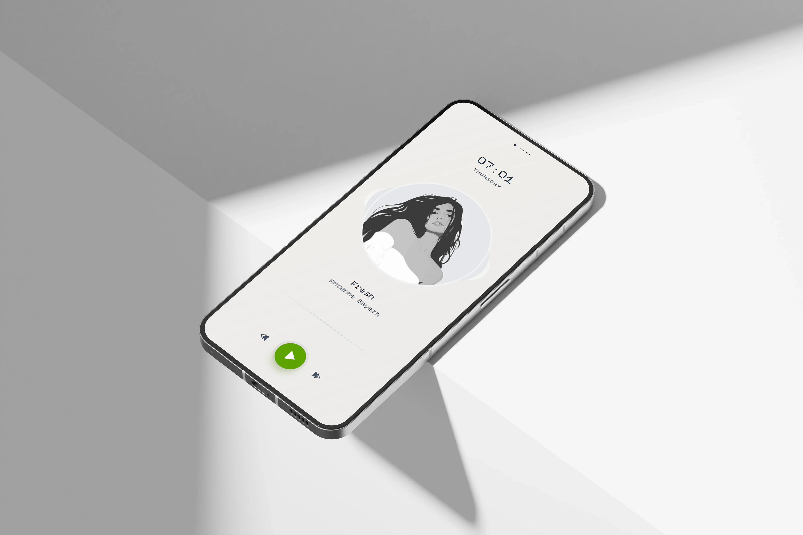

   

   

Features 🧼      

- Built-in live clock   
- Fast and lightweight   
- Full keyboard control   
- Live streaming 4 radio    
- Real-time audio waveform   
- Cloud & Static Hosting Ready     
- Responsive mobile-friendly design   
- Lightweight – no frameworks required   

> [!TIP]
> Multi-station radio player with Modular Architecture.   

- player.js — Audio logic, controls, UI state   
- wave.js — Independent visualizer engine   
- tracks.json — customize radio stations / covers / wave colours   

> [!TIP]
> Keyboard shortcuts   
  
- Space — Play / Pause   
- ← / → — Track navigation   

#### Tech Stack   
```
Bun | Vite | Biome | Tailwind CSS | Vanilla JS   
```   

## Commands

All commands are run from the root of the project:   

| Command           | Action                                          |
| :---------------- | :---------------------------------------------- |
| `bun install`     | Installs dependencies                           |
| `bun run dev`     | Starts local dev server at `localhost:4321`     |
| `bun run build`   | Builds the production site to `./dist/`         |
| `bun run preview` | Previews the build locally                      |
| `bun run check`   | Lints + formats (Biome, applies safe fixes)     |
| `bun run ci`      | Non-mutating Biome check for CI                 |   